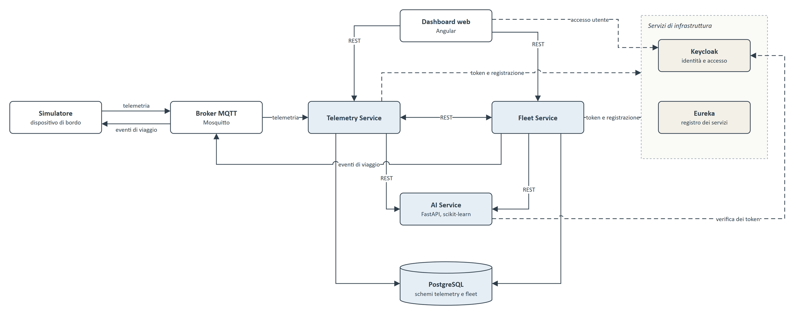

# Pagina di presentazione

Questo repository contiene la pagina di presentazione del progetto.

## Il progetto

Il progetto è un prototipo di sistema IoT per una flotta di auto a noleggio. L'idea è raccogliere i dati di guida dei veicoli per capire lo stile di chi li usa e per stimare quando un'auto ha bisogno di manutenzione, senza basarsi solo sul calendario o sui chilometri percorsi.

Su ogni auto andrebbe montato un dispositivo edge basato su ESP32, collegato a un'unità inerziale MPU-6050, a un GPS NEO-6M e a un adattatore OBD-II con ELM327. Il dispositivo invia le misure a un broker MQTT. Nel prototipo il dispositivo fisico è sostituito da un simulatore, che pubblica messaggi nello stesso formato e può riprodurre tre scenari di guida: calmo, misto e aggressivo.

Il backend salva la telemetria e ne ricava gli eventi di guida, cioè frenate brusche, accelerazioni brusche e curve aggressive. Gestisce poi veicoli, viaggi, sensori e interventi di manutenzione. Ci sono due modelli Random Forest addestrati su dati sintetici. Il primo assegna a ogni viaggio uno stile di guida calmo, normale o aggressivo, il secondo stima su tre livelli il rischio di manutenzione di un veicolo. Se il rischio è alto viene aperta una notifica, che l'operatore della flotta prende in carico e, se serve, trasforma in un intervento pianificato.

L'operatore lavora su una dashboard web e l'accesso passa da Keycloak, con OAuth2 e OpenID Connect. Tutti i componenti sono open source e il sistema completo si avvia in locale con Docker Compose.

## Architettura

Nello schema le linee continue indicano i flussi di dati, quelle tratteggiate l'autenticazione e la registrazione dei servizi.

Il simulatore pubblica la telemetria sul broker MQTT e il Telemetry Service la riceve, la salva e ne ricava gli eventi di guida. Il Fleet Service gestisce veicoli, viaggi, sensori, manutenzioni e notifiche. Quando un viaggio inizia o finisce, il Fleet Service lo comunica sul broker e il simulatore usa questi messaggi per sapere quando trasmettere.

I due servizi si chiamano anche direttamente via REST. Il Telemetry Service chiede al Fleet Service quali sensori sono attivi su un veicolo, mentre il Fleet Service chiede al Telemetry Service i dati di guida aggregati che servono per calcolare il rischio. Per le classificazioni entrambi si rivolgono all'AI Service. La dashboard comunica solo con il Fleet Service e il Telemetry Service.

Keycloak rilascia all'operatore un token con ruolo `OPERATOR`. Quando un servizio ne chiama un altro usa invece un token proprio, ottenuto con il flusso `client_credentials`, che ha il ruolo `INTERNAL_SERVICE`. Fleet Service, Telemetry Service e AI Service controllano il token di ogni richiesta. Fleet Service e Telemetry Service si registrano nel Discovery Server (Eureka) e si trovano tra loro per nome, mentre l'AI Service ha un indirizzo fisso. Il database è un'unica istanza di PostgreSQL con due schemi, `fleet` e `telemetry`, uno per ciascun servizio.

| Componente | Tecnologia | Ruolo |
|---|---|---|
| Simulatore edge | Python, FastAPI, paho-mqtt | prende il posto del dispositivo di bordo e pubblica la telemetria dei viaggi avviati con la simulazione |
| Broker MQTT | Eclipse Mosquitto | collega il simulatore al backend |
| Telemetry Service | Java 21, Spring Boot | riceve e salva la telemetria, rileva gli eventi di guida e calcola il profilo di guida dei viaggi |
| Fleet Service | Java 21, Spring Boot | gestisce veicoli, sensori, viaggi, manutenzioni, rischio e notifiche |
| AI Service | Python, FastAPI, scikit-learn | contiene i modelli per lo stile di guida e il rischio di manutenzione |
| Dashboard web | Angular 18, PrimeNG, ECharts | interfaccia dell'operatore |
| Discovery Server | Spring Cloud Netflix Eureka | registro dei servizi |
| Keycloak | Keycloak 25 | autenticazione e autorizzazione |
| PostgreSQL | PostgreSQL 16 | database, con gli schemi `fleet` e `telemetry` |

## Repository del progetto

- [perfez-2526-edge-simulator-stefano](https://github.com/UniSalento-IDALab-corsoPerfez-25-26/perfez-2526-edge-simulator-stefano): simulatore del dispositivo edge
- [perfez-2526-telemetry-service-stefano](https://github.com/UniSalento-IDALab-corsoPerfez-25-26/perfez-2526-telemetry-service-stefano): Telemetry Service
- [perfez-2526-fleet-service-stefano](https://github.com/UniSalento-IDALab-corsoPerfez-25-26/perfez-2526-fleet-service-stefano): Fleet Service
- [perfez-2526-ai-service-stefano](https://github.com/UniSalento-IDALab-corsoPerfez-25-26/perfez-2526-ai-service-stefano): AI Service
- [perfez-2526-discovery-server-stefano](https://github.com/UniSalento-IDALab-corsoPerfez-25-26/perfez-2526-discovery-server-stefano): Discovery Server (Eureka)
- [perfez-2526-fleet-dashboard-stefano](https://github.com/UniSalento-IDALab-corsoPerfez-25-26/perfez-2526-fleet-dashboard-stefano): dashboard web
- [perfez-2526-infrastructure-stefano](https://github.com/UniSalento-IDALab-corsoPerfez-25-26/perfez-2526-infrastructure-stefano): Docker Compose e configurazione per avviare il sistema completo
- [perfez-2526-presentation-stefano](https://github.com/UniSalento-IDALab-corsoPerfez-25-26/perfez-2526-presentation-stefano): pagina di presentazione del progetto, all'indirizzo https://unisalento-idalab-corsoperfez-25-26.github.io/perfez-2526-presentation-stefano/

## Questo repository

La pagina è fatta con Jekyll e usa il tema Cayman. Il testo si trova in `index.md` e la configurazione, compresi i pulsanti verso le repo dei componenti, in `_config.yml`. Il layout in `_layouts/default.html` riprende quello del tema, in italiano e con il logo nell'intestazione. Il logo è in `assets/logo.svg`, le schermate della dashboard in `assets/schermate/` e gli stili aggiunti in `assets/css/style.scss`.
