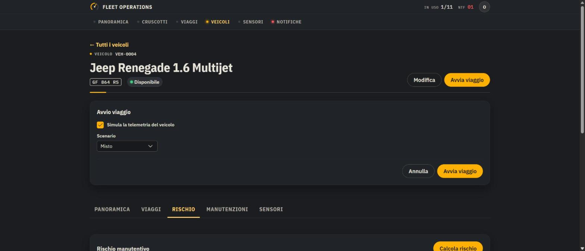
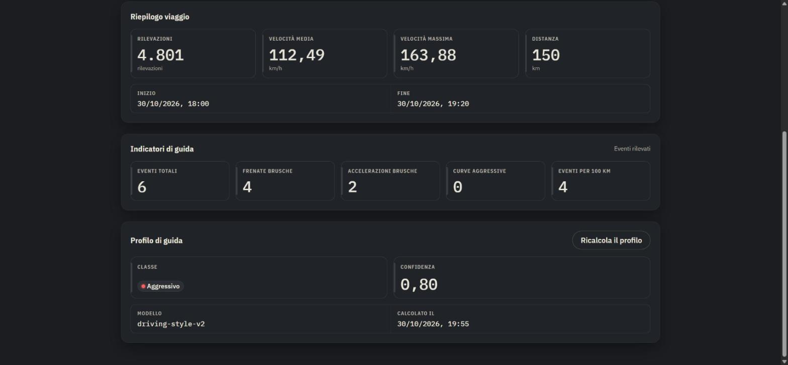
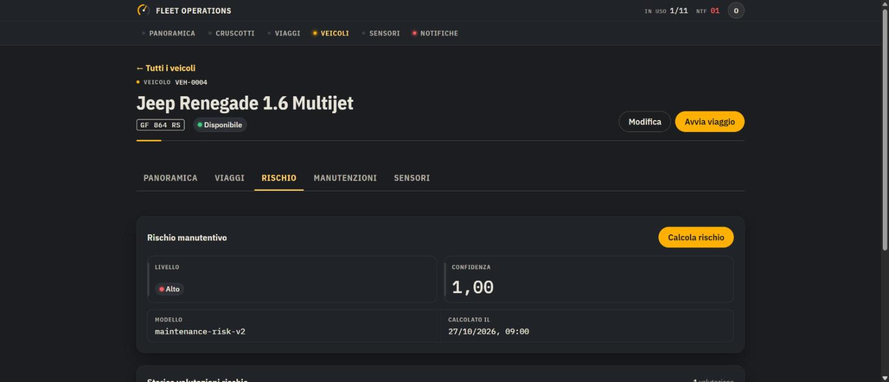
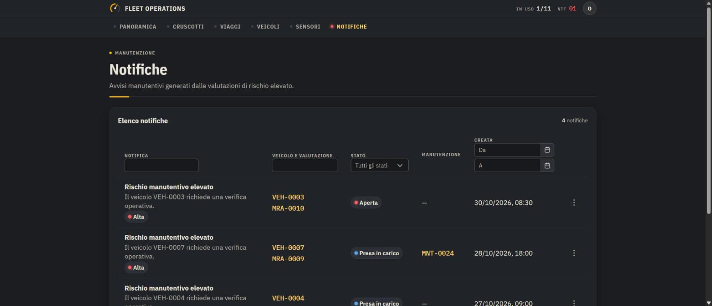
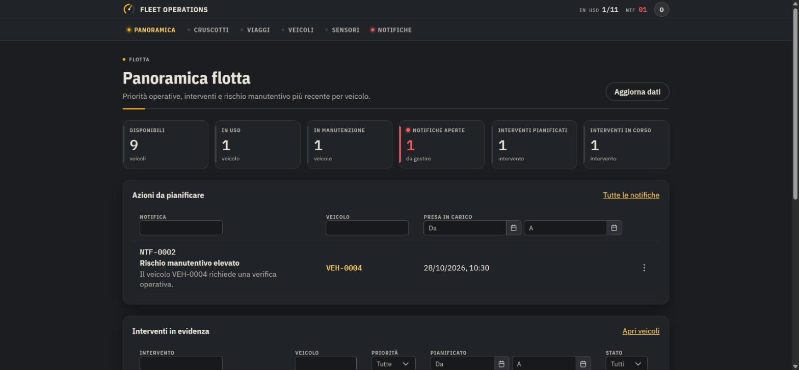
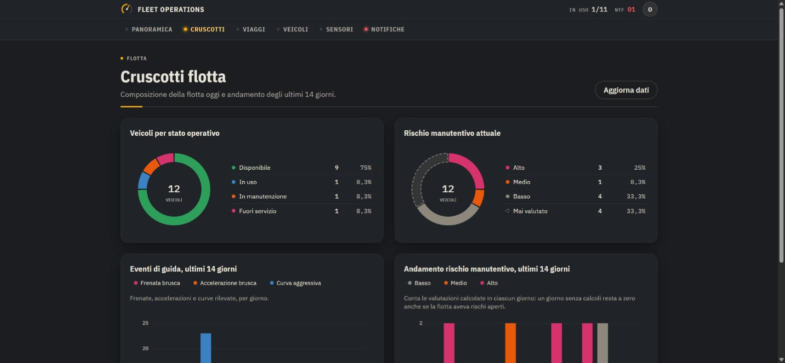
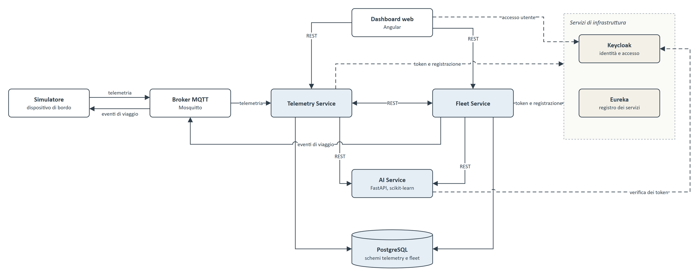

In questa pagina: [Hardware previsto](#hardware-previsto) · [Come funziona](#come-funziona) · [La dashboard](#la-dashboard) · [Architettura](#architettura) · [Repository](#repository) · [Provarlo in locale](#provarlo-in-locale) · [Autore](#autore)

Chi gestisce una flotta di auto a noleggio di solito programma la manutenzione in base al calendario o ai chilometri percorsi. Due auto con gli stessi chilometri, però, possono essere state guidate in modo molto diverso, e questo progetto prova a tenerne conto. Raccoglie i dati di guida dei veicoli e ne ricava lo stile di chi guida. Gli stessi dati, insieme allo storico degli interventi, servono poi a capire quali auto conviene controllare prima.

Il sistema è un prototipo, e il dispositivo di bordo è sostituito da un simulatore software che pubblica messaggi nello stesso formato che avrebbe quello vero.

## Hardware previsto

Il dispositivo da montare su ogni auto userebbe moduli economici e facili da trovare, e il formato dei messaggi segue i dati che questi moduli possono fornire.

| Modulo | Collegamento | Ruolo |
|---|---|---|
| ESP32 (ESP32-WROOM-32) | Wi-Fi verso il broker MQTT | raccoglie i dati degli altri moduli e li pubblica |
| GY-521 con MPU-6050 | I2C | accelerazioni longitudinale e laterale, da cui si ricavano gli eventi di guida |
| GPS u-blox NEO-6M | UART | velocità e distanza percorsa |
| Adattatore OBD-II con ELM327 | UART o Bluetooth | regime e temperatura del motore, tensione della batteria, chilometraggio, codici diagnostici |

## Come funziona

Dalla dashboard l'operatore apre la scheda di un veicolo e avvia un viaggio. Se sceglie di simulare la telemetria, indica anche lo scenario di guida, che può essere calmo, misto o aggressivo.

*L'avvio di un viaggio con la telemetria simulata, dalla scheda del veicolo.*

Il Fleet Service registra il viaggio e lo annuncia sul broker MQTT. Se il viaggio è simulato, il simulatore riceve l'annuncio e comincia a pubblicare le rilevazioni del veicolo, di norma una al secondo, con velocità, accelerazioni, giri e temperatura del motore, tensione della batteria, contachilometri e codici di errore.

Il Telemetry Service riceve i messaggi e li salva. Intanto controlla i valori dell'accelerometro e segna come eventi le frenate brusche, le accelerazioni brusche e le curve prese troppo forte. Le soglie predefinite sono 3 m/s² in frenata e in accelerazione, 2,8 m/s² in curva.

Dal dettaglio di un viaggio si può poi calcolare il profilo di guida. Il Telemetry Service riassume le rilevazioni in alcuni indicatori e li manda all'AI Service, dove un modello Random Forest addestrato su dati sintetici classifica la guida come calma, normale o aggressiva.

*Il riepilogo di un viaggio, con gli eventi rilevati e il profilo di guida.*

Il rischio di manutenzione invece si calcola sul veicolo. Il Fleet Service chiede al Telemetry Service i dati raccolti sul veicolo, li unisce allo storico delle manutenzioni e li passa a un secondo modello, anche questo addestrato su dati sintetici, che risponde con un rischio basso, medio o alto. Se il rischio è alto si apre una notifica. L'operatore la prende in carico e, se lo ritiene utile, pianifica un intervento.

*La scheda del rischio di un veicolo, con l'ultima valutazione del modello.*

*Le notifiche aperte e quelle già prese in carico, con l'eventuale intervento collegato.*

## La dashboard

La panoramica raccoglie lo stato della flotta e le notifiche che aspettano un intervento. Nei cruscotti ci sono la composizione della flotta, il rischio attuale dei veicoli e l'andamento degli eventi di guida e delle valutazioni negli ultimi 14 giorni. Dal menu in alto si raggiungono anche gli elenchi di viaggi, veicoli, sensori e notifiche.

*La panoramica, con i contatori per stato e le notifiche da pianificare.*

*I cruscotti, con la composizione della flotta e il rischio di manutenzione.*

## Architettura

Nello schema le linee continue sono i flussi di dati, quelle tratteggiate riguardano l'autenticazione e la registrazione dei servizi.

Il simulatore e il backend comunicano solo attraverso il broker Mosquitto. Fleet Service e Telemetry Service sono scritti in Java con Spring Boot. Tra loro si scambiano richieste REST e si trovano tramite il Discovery Server, basato su Eureka. L'AI Service è in Python, con FastAPI e scikit-learn. La dashboard è fatta in Angular con PrimeNG e per i dati parla solo con i due servizi Java.

L'operatore accede tramite Keycloak con il suo utente, mentre i servizi, quando si chiamano tra loro, usano token di servizio. I dati stanno in un solo database PostgreSQL, con uno schema per il Fleet Service e uno per il Telemetry Service.

## Repository

Ogni componente ha il suo repository, con un README che lo descrive.

- [perfez-2526-edge-simulator-stefano](https://github.com/UniSalento-IDALab-corsoPerfez-25-26/perfez-2526-edge-simulator-stefano), il simulatore del dispositivo di bordo
- [perfez-2526-telemetry-service-stefano](https://github.com/UniSalento-IDALab-corsoPerfez-25-26/perfez-2526-telemetry-service-stefano), il Telemetry Service
- [perfez-2526-fleet-service-stefano](https://github.com/UniSalento-IDALab-corsoPerfez-25-26/perfez-2526-fleet-service-stefano), il Fleet Service
- [perfez-2526-ai-service-stefano](https://github.com/UniSalento-IDALab-corsoPerfez-25-26/perfez-2526-ai-service-stefano), l'AI Service
- [perfez-2526-discovery-server-stefano](https://github.com/UniSalento-IDALab-corsoPerfez-25-26/perfez-2526-discovery-server-stefano), il Discovery Server
- [perfez-2526-fleet-dashboard-stefano](https://github.com/UniSalento-IDALab-corsoPerfez-25-26/perfez-2526-fleet-dashboard-stefano), la dashboard
- [perfez-2526-infrastructure-stefano](https://github.com/UniSalento-IDALab-corsoPerfez-25-26/perfez-2526-infrastructure-stefano), la configurazione di Docker Compose, Keycloak, Mosquitto e PostgreSQL

## Provarlo in locale

Per provarlo servono Docker e Git (le istruzioni complete sono nel [repository dell'infrastruttura](https://github.com/UniSalento-IDALab-corsoPerfez-25-26/perfez-2526-infrastructure-stefano)). In breve, si clonano i sette repository nella stessa cartella, si avvia tutto con Docker Compose e si caricano i dati di prova, che contengono 12 veicoli e 29 viaggi. A quel punto la dashboard risponde all'indirizzo `http://localhost:4200` e si entra con utente e password `operator`.

## Autore

Alessandro Stefano ([alessandrostefano2@hotmail.it](mailto:alessandrostefano2@hotmail.it), su GitHub [AleSte27](https://github.com/AleSte27))
